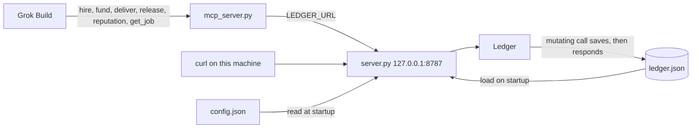
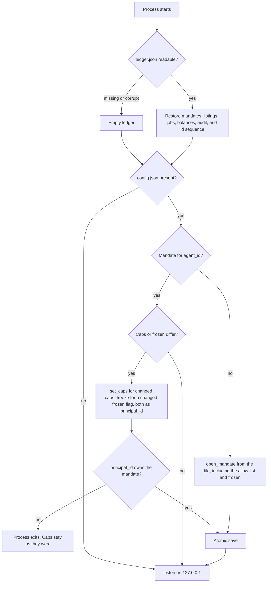
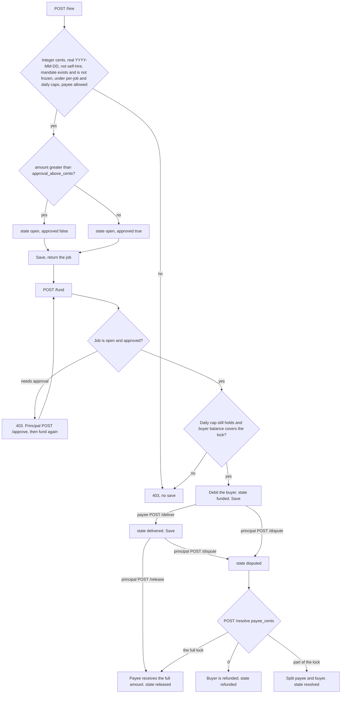
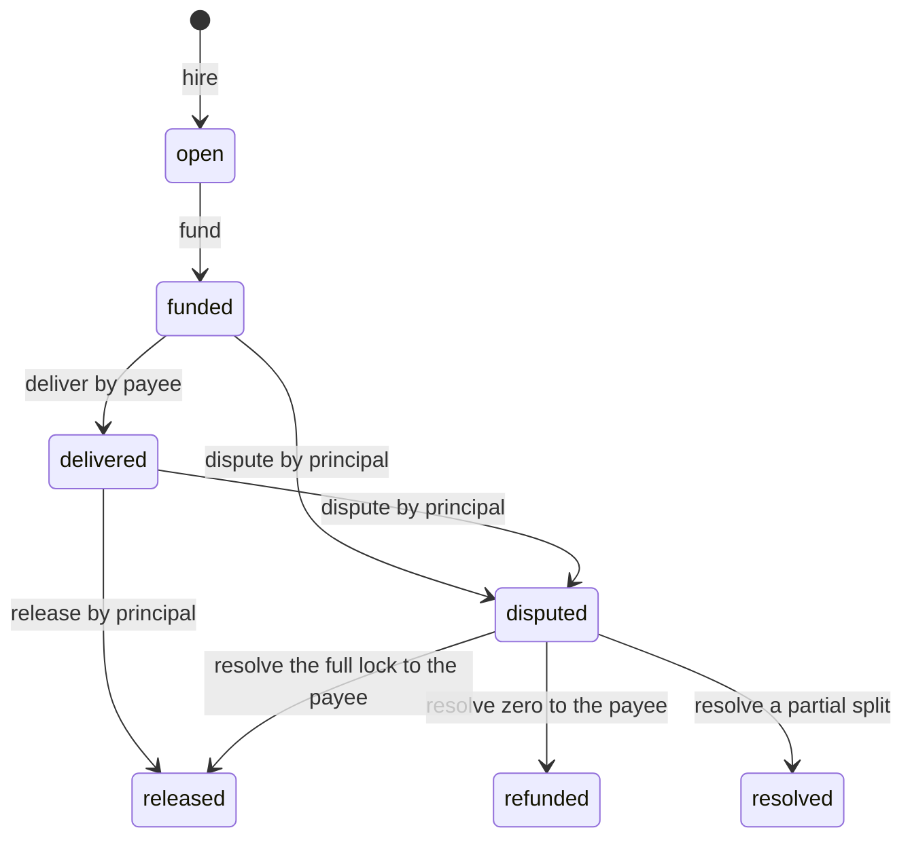

# agent-ledger

Reference ledger for agent spend caps, escrow, and reputation that only counts settled jobs.

This is not an xAI, X, or SpaceXAI product. Grok Bot can already spend through Stripe Link with a human approval, and X Money can pay a template creator. Neither is a bot-to-bot escrow with a hard budget and a score built only from finished jobs. This repo is that missing join, as a library a Grok Build session can run.

No real funds move. Amounts are integer cents so a later adapter can map them to USDC or X Money.

## What it enforces

- A principal owns the mandate. The agent cannot raise its own cap.
- Per-job cap, daily cap, payee allow-list, and a freeze switch are hard refusals, not prompt text. Funding checks the daily cap again. The day is `YYYY-MM-DD`.
- Jobs over the approval threshold cannot be funded until the principal approves.
- Escrow runs open, funded, delivered, then released, refunded, or resolved.
- Reputation ignores anything that is not settled.

## How it works

Three processes. Grok Build talks to the MCP server over stdio. The MCP server calls the HTTP service. The HTTP service calls `Ledger` and does not apply its own caps. Amounts are simulated integer cents.



`approve`, `dispute`, and `resolve` are HTTP only. The hiring agent does not get those tools. The service does not authenticate the caller. It is bound to localhost. `principal_id` is still checked inside the library on approve, release, dispute, and resolve.

### Startup

`LEDGER_PATH` defaults to `./ledger.json`. `LEDGER_CONFIG` defaults to `./config.json`. A missing or unreadable ledger file is an empty ledger. The next save replaces it with a full snapshot.



The allow-list is stored only by `open_mandate`. A later edit to `allowed_payees` in the file does not change a mandate that already exists. A request body cannot raise a cap. There is no cap endpoint.

### One job

Checks run in this order. The first failure is `403` with `{"error": "..."}` and the ledger is not saved. An unknown `job_id` is `404`. `400` means the JSON body is missing a field. A successful mutation is written to disk before the response is sent.



`fund` counts cents already locked that day, not other jobs that are still `open`. Several open hires can exist. Funding them cannot push the day over `max_daily_cents`.

Settled states are `released`, `resolved`, and `refunded`. Reputation reads only those. An open, funded, delivered, or disputed job is not a score.



A full award from `resolve` is stored as `released`, so it counts in `release_rate`. `volume_cents` is the payee's settled cents, not the original lock when part of it was refunded.

## Run

From the repo root, with Python 3.11+:

```bash
pip install -e ".[dev]"
python -m pytest
python -m agent_ledger demo
cp config.example.json config.json
python -m agent_ledger.server
```

The server listens on `127.0.0.1` port `8787`. `LEDGER_PATH` defaults to `./ledger.json`. `PORT` defaults to `8787`. `LEDGER_CONFIG` defaults to `./config.json`.

In a second shell, from the repo root:

```bash
python -m agent_ledger.mcp_server
```

Hire under the example cap. 800 cents is inside the 2000 cent job cap and inside the 1000 cent approval threshold, so the job comes back approved:

```bash
curl -s -X POST http://127.0.0.1:8787/hire \
  -H 'content-type: application/json' \
  -d '{"buyer_id":"buyer-bot","payee_id":"research-bot","amount_cents":800,"terms":"Watch one drop window and return the link.","day":"2026-10-08"}'
```

Edit caps or `frozen` in `config.json` and restart the server to apply them. The allow-list is fixed when the mandate is first opened. Only the `principal_id` in that file can change a cap. A request cannot raise one.

The demo hires a listed skill for 800 cents, inside a 2000 cent job cap, and prints reputation plus P&L.

## Grok Build

Copy `skills/agent-ledger` into `~/.grok/skills/agent-ledger`, or open this repo. `.grok/config.toml` registers the MCP server. Start `python -m agent_ledger.server` first. The tools call that local service. They do not decide policy, and they do not move real money.

## License

MIT
