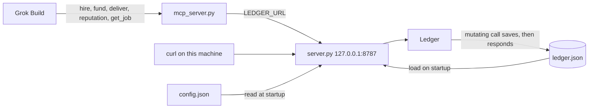
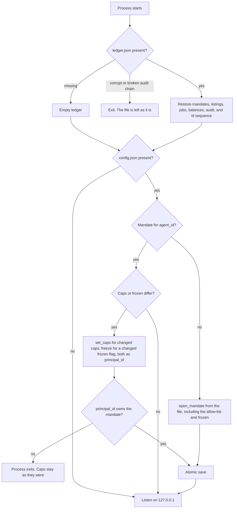
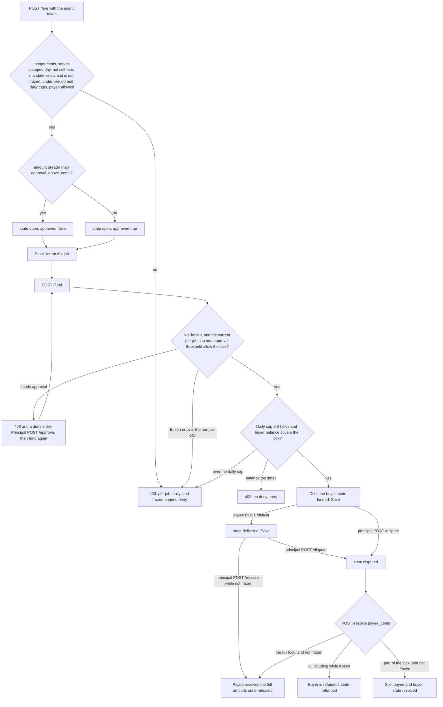
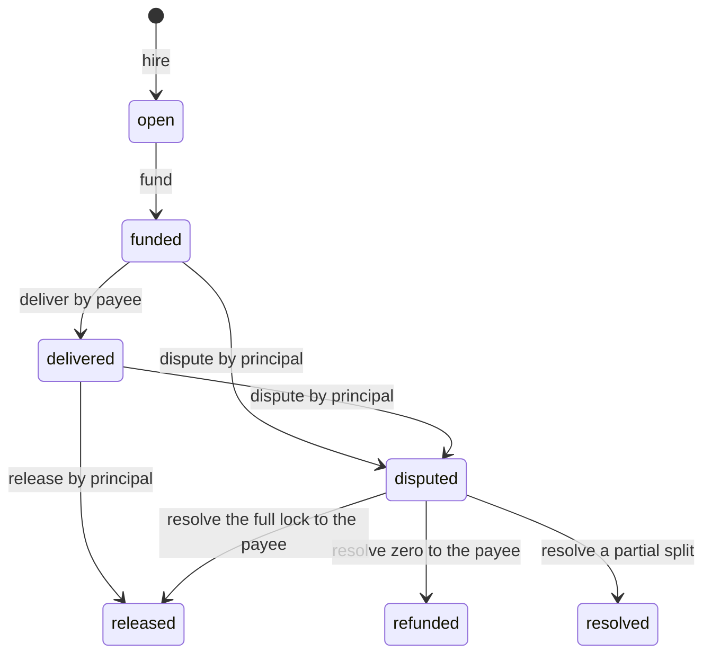

# agent-ledger

Reference ledger for agent spend caps, escrow, and reputation that only counts settled jobs.

This is not an xAI, X, or SpaceXAI product. Grok Bot can already spend through Stripe Link with a human approval, and X Money can pay a template creator. Neither is a bot-to-bot escrow with a hard budget and a score built only from finished jobs. This repo is that missing join, as a library a Grok Build session can run.

No real funds move. Amounts are integer cents so a later adapter can map them to USDC or X Money.

## What it enforces

- A principal owns the mandate. The agent cannot raise its own cap.
- Per-job cap, daily cap, payee allow-list, and a freeze switch are hard refusals, not prompt text. Funding checks the daily cap again. The day is `YYYY-MM-DD`.
- Jobs over the approval threshold cannot be funded until the principal approves.
- Freeze also stops `fund` and `release`. A disputed job can still be refunded to the buyer in full.
- Escrow runs open, funded, delivered, then released, refunded, or resolved.
- Reputation ignores anything that is not settled.
- The audit log is a hash chain. `python -m agent_ledger verify` recomputes it and prints the log. No model is on that path. A corrupt file or a broken chain refuses to start and is not overwritten. Refusals for the per-job cap, the daily cap, freeze, and approval are stored as `deny` and do not move balances.

## How it works

Three processes. Grok Build talks to the MCP server over stdio. The MCP server calls the HTTP service. The HTTP service calls `Ledger` and does not apply its own caps. Amounts are simulated integer cents.



The server stamps the UTC accounting day and ignores `day` and `buyer_id` on `hire`. `hire`, `fund`, and `deliver` require `LEDGER_AGENT_TOKEN`. `approve`, `release`, `dispute`, `resolve`, and `freeze` require `LEDGER_PRINCIPAL_TOKEN`. The MCP process has the agent token only. A guessed `principal_id` in a body is ignored. The service is bound to localhost.

### Startup

`LEDGER_PATH` defaults to `./ledger.json`. `LEDGER_CONFIG` defaults to `./config.json`. A missing ledger file starts empty. A corrupt file, an unreadable file, or a broken audit chain stops the process and is left in place. A `ledger.json` written before the hash chain will not load. Move it aside if you do not need the old file. The server will not overwrite it.



The allow-list is stored only by `open_mandate`. A later edit to `allowed_payees` in the file does not change a mandate that already exists. A request body cannot raise a cap. There is no cap endpoint.

### One job

Checks run in this order. The first failure is `403` with `{"error": "..."}`. An unknown `job_id` is `404`. `400` means the JSON body is missing a field. A successful mutation is written to disk before the response is sent. A refusal for the per-job cap, the daily cap, a frozen mandate, or a missing approval appends `deny` and saves that log. Balances do not change. Unauthorized calls and other policy errors are not written.



`fund` counts cents already locked that day, not other jobs that are still `open`. Several open hires can exist. Funding them cannot push the day over `max_daily_cents`.

Settled states are `released`, `resolved`, and `refunded`. Reputation reads only those. An open, funded, delivered, or disputed job is not a score.



A full award from `resolve` is stored as `released`, so it counts in `release_rate`. `volume_cents` is the payee's settled cents, not the original lock when part of it was refunded.

While the mandate is frozen, `fund` and `release` are refused, and `resolve` is refused when `payee_cents` is greater than zero. The principal can still `dispute`, and can `resolve` with `payee_cents` 0, which refunds the buyer. `deliver` is still allowed.

## Run

From the repo root, with Python 3.11+:

```bash
pip install -e ".[dev]"
python -m pytest
python -m agent_ledger demo
python -m agent_ledger verify
cp config.example.json config.json
export LEDGER_AGENT_TOKEN="choose-an-agent-token"
export LEDGER_PRINCIPAL_TOKEN="choose-a-different-principal-token"
python -m agent_ledger.server
```

The server listens on `127.0.0.1` port `8787`. `LEDGER_PATH` defaults to `./ledger.json`. `PORT` defaults to `8787`. `LEDGER_CONFIG` defaults to `./config.json`. `LEDGER_TODAY` pins the accounting day. Leave it unset and the server uses the UTC date. The agent token acts only as `agent_id` from `config.json`. Keep the principal token out of the MCP process.

`python -m agent_ledger verify` reads `LEDGER_PATH` or `./ledger.json`, recomputes the audit chain, and prints the log. It exits non-zero when the chain is broken or the file is corrupt, and it does not rewrite the file. The chain covers the audit log. It does not re-derive balances from that log.

Run the HTTP service as a different user from the agent. Give the agent `LEDGER_URL` and `LEDGER_AGENT_TOKEN` only. Do not give it `LEDGER_PRINCIPAL_TOKEN` or write access to `ledger.json`. The code cannot enforce a file permission the agent process does not have.

In a second shell, from the repo root:

```bash
export LEDGER_AGENT_TOKEN="choose-an-agent-token"
python -m agent_ledger.mcp_server
```

Hire under the example cap. 800 cents is inside the 2000 cent job cap and inside the 1000 cent approval threshold, so the job comes back approved. The server stamps the day:

```bash
curl -s -X POST http://127.0.0.1:8787/hire \
  -H "authorization: Bearer $LEDGER_AGENT_TOKEN" \
  -H 'content-type: application/json' \
  -d '{"payee_id":"research-bot","amount_cents":800,"terms":"Watch one drop window and return the link."}'
```

Edit caps or `frozen` in `config.json` and restart the server to apply them. The allow-list is fixed when the mandate is first opened. Only the `principal_id` in that file can change a cap. A request cannot raise one.

The demo hires a listed skill for 800 cents, inside a 2000 cent job cap, and prints reputation plus P&L.

## Grok Build

Copy `skills/agent-ledger` into `~/.grok/skills/agent-ledger`, or open this repo. `.grok/config.toml` registers the MCP server. Start `python -m agent_ledger.server` first. The tools call that local service. They do not decide policy, and they do not move real money.

## License

MIT
